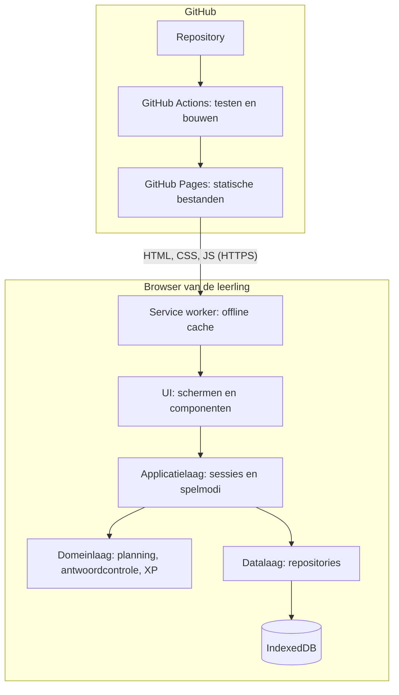
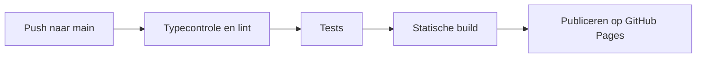

# Architectuur Level Up (voorstel)

Status: concept, ter bespreking

Dit document beschrijft de architectuur van de MVP (fase 1) en hoe die later kan groeien. Het hoort bij [requirements.md](./requirements.md) en [design-system.md](./design-system.md); verwijzingen zoals AC-01 slaan op requirements uit het eerste document.

## 1. Uitgangspunten

| Uitgangspunt | Gevolg |
|---|---|
| Hosting op GitHub Pages | Alleen statische bestanden; er draait geen eigen servercode |
| Geen backend in fase 1 | Alle logica en alle gegevens staan in de browser (AC-01) |
| Geen accounts in fase 1 | Voortgang is gebonden aan één browser op één apparaat |
| Later uitbreidbaar | Opslag zit achter een interface, zodat een backend kan worden toegevoegd zonder de leerlogica te herschrijven |

## 2. Overzicht



Na het laden van de app is er geen verkeer meer nodig: oefenen, scores en voortgang werken volledig lokaal.

## 3. Technologiekeuzes

| Onderdeel | Keuze | Reden |
|---|---|---|
| Taal | TypeScript | Typecontrole op het datamodel en de leerlogica |
| Framework | SvelteKit met `adapter-static` | Kleine bundels, statische uitvoer, routering en service worker ingebouwd |
| Styling | Gewone CSS met de variabelen uit het design system | Geen extra afhankelijkheid; thema's via variabelen |
| Opslag | IndexedDB via Dexie | Gestructureerde gegevens, indexen en schema-migraties |
| Offline | Service worker van SvelteKit | Solo-modi werken zonder verbinding (NF-06) |
| Tests | Vitest (logica) en Playwright (schermen) | Geautomatiseerde tests op de leerlogica (NF-16) |
| Bouwen en publiceren | GitHub Actions | Elke wijziging op `main` wordt getest en gepubliceerd |

Besluit: het framework is SvelteKit. De afweging staat hieronder.

### Vergelijking van frameworks

Alle drie de opties kunnen een statische site voor GitHub Pages opleveren.

| Optie | Voordelen | Nadelen |
|---|---|---|
| SvelteKit (statisch) | Kleinste bundels, dus snel op goedkope telefoons; overgangen en animaties ingebouwd; routering en service worker ingebouwd; weinig code per component | Kleiner ecosysteem en minder kant-en-klare componenten dan React; minder ontwikkelaars kennen het; Svelte 5 werkt anders dan oudere versies, waardoor veel voorbeelden online verouderd zijn |
| Next.js (statische export) | Grootste ecosysteem (React); veel ontwikkelaars, voorbeelden en bibliotheken; goed ondersteund door AI-hulpmiddelen | De sterke punten (servercomponenten, API-routes, beeldoptimalisatie, middleware) werken niet bij statische export; grotere basisbundel; meer complexiteit dan deze app nodig heeft; dynamische paden voor lokaal aangemaakte lijsten zijn omslachtig; offline-ondersteuning vraagt extra opzet |
| Vite met React (SPA) | Eenvoudige opzet zonder serverconcepten; hetzelfde grote React-ecosysteem; past goed bij een app die volledig in de browser draait | Routering, offline-ondersteuning en animaties moeten als losse bibliotheken worden gekozen en onderhouden; grotere bundel dan Svelte |

**Besluit:** SvelteKit. De app is klein, draait volledig in de browser en moet snel en soepel zijn op telefoons; de voordelen van Next.js vallen bij statische hosting grotendeels weg. Vite met React is het beste alternatief als kennis van React of de omvang van het ecosysteem zwaarder weegt.

## 4. Lagen

| Laag | Verantwoordelijkheid | Mag afhangen van |
|---|---|---|
| UI | Schermen, componenten, animaties | Applicatielaag |
| Applicatie | Verloop van een sessie, spelmodi, timer, combo | Domein, datalaag |
| Domein | Gespreide herhaling, antwoordcontrole, typo-tolerantie, XP, niveaus, weekdoel | Niets |
| Data | Opslaan en ophalen via repositories | Domeintypes |

- De domeinlaag bestaat uit pure functies zonder browser-API's, zonder opslag en zonder de klok: de huidige tijd wordt als parameter meegegeven. Daardoor is deze laag volledig te testen en later ook op een server te gebruiken (NF-13).
- De applicatielaag kent alleen de repository-interfaces, niet IndexedDB zelf.

### Voorgestelde mapindeling

```text
src/
  lib/
    domain/        planning, antwoordcontrole, xp, types
    data/          repository-interfaces en IndexedDB-implementatie
    app/           sessie-engine en spelmodi
    ui/            herbruikbare componenten
    styles/        design tokens en basisstijlen
  routes/          schermen
static/            iconen, manifest, lettertypes
  lists/           meegeleverde woordlijsten
tests/             end-to-end tests
```

### Algoritme voor gespreide herhaling

| Optie | Werking | Voordelen | Nadelen |
|---|---|---|---|
| Leitner (bakjes) | Elk item zit in een bakje met een vast interval; goed is een bakje vooruit, fout is terug naar het begin | Eenvoudig te bouwen, te testen en uit te leggen; de bakjes sluiten direct aan op de beheersingsniveaus; alleen goed of fout nodig | Vaste intervallen voor iedereen; houdt geen rekening met de moeilijkheid van een woord; één fout zet een goed gekend woord ver terug |
| SM-2 (bekend van Anki) | Per item een eigen factor die het interval na elke herhaling vermenigvuldigt | Past zich aan per item; breed bekend en goed gedocumenteerd | Vraagt een oordeel op een schaal, dat uit goed, bijna goed, fout en antwoordtijd moet worden afgeleid; moeilijke woorden kunnen blijven hangen op korte intervallen; minder nauwkeurig dan FSRS |
| FSRS | Model dat per item de kans op onthouden schat en plant op een gewenst percentage | Meest efficiënt: minder herhalingen voor hetzelfde resultaat; gewenste beheersing is instelbaar; er bestaat een open-source TypeScript-implementatie | Complexer en lastig uit te leggen; vraagt ook een oordeel op een schaal; de standaardwaarden zijn afgeleid van andere gebruikers dan scholieren; het voordeel is klein bij leren voor een toets over enkele dagen |

**Besluit:** Leitner voor de MVP. Scholieren leren meestal voor een toets binnen één of twee weken, waardoor het voordeel van de geavanceerdere modellen beperkt is, en de bakjes maken de voortgang begrijpelijk. De planning zit achter één functie in de domeinlaag en elk antwoord wordt vastgelegd (tabel `reviews`), zodat later zonder verlies van historie kan worden overgestapt op FSRS.

Standaardwaarden (besluit):

| Bakje | Interval tot volgende herhaling | Beheersingsniveau |
|---|---|---|
| 0 | Nog niet geoefend | Nieuw |
| 1 | 1 dag | Geoefend |
| 2 | 3 dagen | Geoefend |
| 3 | 7 dagen | Bekend |
| 4 | 14 dagen | Bekend |
| 5 | 30 dagen | Beheerst |

- Goed: één bakje vooruit. Fout: terug naar bakje 1 (LD-06). Bijna goed: het item blijft in hetzelfde bakje (LD-07).
- Het bakje wordt per item en per richting bijgehouden.
- De leerling kan het aantal dagen per bakje zelf aanpassen in de instellingen (LD-16). De intervallen moeten minimaal 1 dag zijn en per bakje oplopen; de standaardwaarden zijn met één handeling te herstellen.
- Een gewijzigd interval geldt vanaf het eerstvolgende antwoord op een item; al geplande herhalingen houden hun datum. De koppeling tussen bakje en beheersingsniveau verandert niet.

## 5. Gegevensmodel

Alle gegevens staan in één IndexedDB-database met de naam `level-up`.

| Tabel | Sleutel | Belangrijkste velden |
|---|---|---|
| `lists` | `id` | titel, brontaal, doeltaal, herkomst (eigen of meegeleverd), versie, aangemaakt, gewijzigd |
| `items` | `id` | `listId`, term, vertaling, alternatieve antwoorden, voorbeeldzin |
| `progress` | `itemId` + `direction` | bakje, volgende herhaling, aantal goed, aantal fout, laatst geoefend |
| `reviews` | `id` | `itemId`, richting, resultaat (goed, bijna goed, fout), vraagvorm, antwoordtijd, tijdstip |
| `sessions` | `id` | `listId`, richting, modus, score, verdiende XP, begin, einde |
| `highscores` | `listId` + `direction` + modus | hoogste score, datum |
| `profile` | vaste sleutel | totaal XP, niveau, weekdoel, intervallen per bakje, overige instellingen |
| `activity` | datum | of er die dag geoefend is (voor het weekdoel) |

- `direction` is `forward` (brontaal naar doeltaal) of `backward`. Voortgang en highscores zijn daardoor per richting gescheiden (LD-01, LD-02, SM-04).
- Elk record heeft een willekeurig gegenereerde `id` (UUID) en een tijdstip van laatste wijziging. Dat is in fase 1 niet nodig, maar maakt synchronisatie met een server later mogelijk.
- Het databaseschema heeft een versienummer; elke wijziging krijgt een migratie, zodat bestaande voortgang bij een update behouden blijft.

### Meegeleverde woordlijsten

Woordlijsten kunnen als statische bestanden met de app op GitHub Pages worden gepubliceerd (WL-11).

```text
static/lists/
  index.json            catalogus van alle lijsten
  fr-nl-basis-1.json    één bestand per lijst
```

De catalogus bevat per lijst alleen de gegevens voor het overzicht:

```json
{
  "lists": [
    {
      "id": "fr-nl-basis-1",
      "version": 1,
      "title": "Frans basiswoorden 1",
      "source": "nl",
      "target": "fr",
      "itemCount": 2,
      "file": "fr-nl-basis-1.json"
    }
  ]
}
```

Een lijstbestand bevat de items:

```json
{
  "id": "fr-nl-basis-1",
  "version": 1,
  "title": "Frans basiswoorden 1",
  "source": "nl",
  "target": "fr",
  "items": [
    { "id": "huis", "term": "het huis", "translation": "la maison" },
    { "id": "fiets", "term": "de fiets", "translation": "le vélo", "alternatives": ["la bicyclette"] }
  ]
}
```

- De app toont de catalogus als bibliotheek. Kiest de leerling een lijst, dan wordt die naar IndexedDB gekopieerd; daarna werkt de lijst offline en hoort de voortgang erbij, net als bij een eigen lijst.
- Elk item heeft een vaste `id` binnen de lijst. Bij een nieuwe versie worden items op die `id` bijgewerkt, zodat de voortgang behouden blijft (WL-12). Een `id` wordt daarom nooit hergebruikt voor een ander woord.
- De eerste meegeleverde lijst is Nederlands–Frans.
- Meegeleverde lijsten worden toegevoegd of gewijzigd door wie schrijfrechten heeft op de repository, via een commit of het samenvoegen van een pull request. Een leerling voegt in de browser alleen lijsten toe aan de eigen lokale opslag: uit de bibliotheek of zelf aangemaakt (WL-01, WL-03).
- De publicatie loopt mee met de gewone workflow. De workflow controleert elk lijstbestand op geldige opbouw en unieke `id`'s.
- De catalogus wordt bij het openen van de bibliotheek opgehaald; lijstbestanden pas bij het kiezen. Zo blijft de eerste keer laden snel, ook bij veel lijsten.
- De repository is openbaar, dus iedereen kan de lijsten inzien. Woordlijsten uit lesmethodes zijn auteursrechtelijk beschermd en mogen niet zonder toestemming van de uitgever worden opgenomen; eigen lijsten en vrij beschikbare lijsten wel.

## 6. Lokale opslag: gevolgen en maatregelen

Opslag in de browser heeft beperkingen die de leerling moet kunnen begrijpen.

| Risico | Toelichting | Maatregel |
|---|---|---|
| Gegevens kwijt | Browsergegevens wissen, privévenster of een ander apparaat betekent: geen voortgang | Export en import van alle gegevens als JSON-bestand; duidelijke uitleg in de app |
| Automatisch opruimen | Browsers mogen opslag wissen bij ruimtegebrek; Safari wist opslag van sites die een week niet zijn gebruikt | Blijvende opslag aanvragen (`navigator.storage.persist()`); installeren als app aanraden |
| Gedeeld apparaat | Op een schoolcomputer delen leerlingen dezelfde browser | Waarschuwing bij eerste gebruik; geen persoonsgegevens opslaan |
| Gedeelde origin | Alle projectsites van één GitHub-account delen `<account>.github.io` en daarmee dezelfde opslag | Opgelost door het eigen subdomein (paragraaf 7); daarnaast een unieke databasenaam |
| Manipulatie | Een leerling kan lokale scores en XP aanpassen | Geaccepteerd in fase 1; er zijn nog geen ranglijsten |
| Klok van het apparaat | De herhaalplanning gebruikt de tijd van het apparaat | Geaccepteerd in fase 1 |

Besluit: het is in fase 1 acceptabel dat voortgang verloren gaat bij het wissen van browsergegevens. Export en import is het vangnet en is als AC-07 opgenomen in fase 1.

## 7. Hosting op GitHub Pages

### Wat dit betekent voor de app

| Onderwerp | Gevolg | Oplossing |
|---|---|---|
| Basispad | Zonder eigen domein staat een projectsite op `https://<account>.github.io/level-up/`; met het eigen subdomein op de hoofdmap | Basispad als instelling van de build; alle links relatief aan dat pad |
| Routering | Er zijn geen herschrijfregels; een onbekend pad geeft een 404 | De app ook als `404.html` publiceren, zodat directe links en verversen werken |
| Jekyll | Mappen die met een underscore beginnen worden standaard overgeslagen | Een leeg bestand `.nojekyll` meepubliceren |
| HTTP-headers | Eigen headers instellen kan niet | Content Security Policy via een `meta`-tag |
| Caching | GitHub bepaalt de cacheduur | Bestandsnamen met een hash; de service worker regelt updates |
| HTTPS | Standaard aanwezig | Vereist voor de service worker en voor installeren als app |

### Beperkingen van GitHub Pages

- De gepubliceerde site is altijd openbaar. Besluit: de repository wordt ook openbaar, zodat een gratis account volstaat.
- Er gelden limieten (ongeveer 1 GB per site en 100 GB verkeer per maand); voor deze app is dat ruim voldoende.
- GitHub Pages is niet bedoeld voor commerciële diensten. Dat is relevant voor het verdienmodel (open vraag in de requirements).
- GitHub registreert de IP-adressen van bezoekers en is een Amerikaanse dienst. De leergegevens verlaten de browser niet, maar dit moet wel in de privacyverklaring staan en past mogelijk niet bij NF-11 zodra scholen de app gaan gebruiken.

### Eigen domein

Een eigen domein kan via DNS aan GitHub Pages worden gekoppeld; een eigen webserver is niet nodig.

Besluit: de app komt op `https://levelup.mind4.dev`.

| Variant | DNS-record | Opmerking |
|---|---|---|
| Subdomein `levelup.mind4.dev` | `CNAME` voor `levelup` in de zone `mind4.dev` naar `<account>.github.io` | Gekozen: eenvoudig en ongevoelig voor wijzigingen aan de kant van GitHub |
| Hoofddomein, bijvoorbeeld `example.nl` | Vier `A`-records naar `185.199.108.153`, `185.199.109.153`, `185.199.110.153` en `185.199.111.153` | Niet gekozen; ter referentie. Controleer de adressen in de documentatie van GitHub |

Stappen:

1. Verifieer het domein in de accountinstellingen van GitHub (een `TXT`-record). Dit voorkomt dat iemand anders het domein aan een eigen site koppelt.
2. Maak het DNS-record aan.
3. Vul het domein in bij de Pages-instellingen van de repository.
4. Wacht tot GitHub het certificaat heeft aangevraagd en zet daarna "Enforce HTTPS" aan. Het certificaat is gratis en wordt automatisch vernieuwd.

Gevolgen voor de app:

- Browsers openen `.dev`-domeinen alleen via HTTPS. De site is daarom pas bereikbaar nadat GitHub het certificaat heeft uitgegeven; reken op enige wachttijd na het aanmaken van het DNS-record.
- De app staat op de hoofdmap van het domein; het subpad `/level-up/` vervalt. Het basispad is een instelling van de build, zodat beide varianten werken.
- De opslag in de browser is niet meer gedeeld met andere projectsites van hetzelfde account.
- Opslag is gebonden aan het adres. Koppel het domein daarom vóór de eerste gebruikers; wie daarvoor al op het `github.io`-adres heeft geoefend, moet de voortgang via export en import overzetten.
- Een latere verhuizing naar een andere hoster is alleen een DNS-wijziging; het adres en dus de voortgang van leerlingen blijven behouden.

### Publiceren



- De workflow gebruikt de officiële Pages-acties van GitHub (`actions/upload-pages-artifact` en `actions/deploy-pages`); in de repository-instellingen staat de bron van Pages op "GitHub Actions".
- Bij een pull request draaien controle, tests en build, maar wordt er niet gepubliceerd.
- Er zijn geen geheimen of sleutels nodig, omdat er geen backend is.

## 8. Offline en updates

- De service worker bewaart bij het eerste bezoek alle bestanden van de app, inclusief lettertypes en iconen.
- Het bereik van de service worker is het subpad van de app, niet het hele domein.
- Bij een nieuwe versie toont de app een melding "Nieuwe versie beschikbaar"; de update wordt pas actief buiten een lopende sessie, zodat een oefening nooit wordt onderbroken.
- Een webmanifest maakt de app installeerbaar op het startscherm.

## 9. Beveiliging en privacy

- Er worden in fase 1 geen persoonsgegevens verzameld of verstuurd; er is geen account, geen analytics en geen tracker (NF-09, NF-10).
- Lettertypes en iconen worden met de app meegeleverd; er worden geen bestanden van andere domeinen geladen.
- Een strikte Content Security Policy staat alleen bronnen van de eigen origin toe.
- Geïmporteerde woordlijsten worden als tekst behandeld en nooit als HTML weergegeven.

## 10. Dekking van de MVP-requirements

| Requirements | Onderdeel van de architectuur |
|---|---|
| WL-01 t/m WL-05 | Tabellen `lists` en `items`; importparser in de domeinlaag |
| WL-11, WL-12 | Statische lijstbestanden in `static/lists/`, gekopieerd naar IndexedDB |
| AC-07 | Export en import van de hele database als JSON-bestand |
| LD-16 | Intervallen per bakje als instelling in `profile`; de planning leest ze als parameter |
| LD-01 t/m LD-09 | Planning en antwoordcontrole in de domeinlaag; tabel `progress` per richting |
| SM-01 t/m SM-05 | Sessie-engine en spelmodi in de applicatielaag; tabel `highscores` |
| BM-01 t/m BM-05 | XP en niveaus in de domeinlaag; tabellen `profile` en `activity` |
| AC-01 | IndexedDB, geen account |
| NF-04 | Antwoordcontrole lokaal, zonder netwerk |
| NF-06 | Service worker en webmanifest |
| NF-16 | Domeinlaag als pure functies met tests |

## 11. Groeipad

| Fase | Wijziging | Gevolg voor de architectuur |
|---|---|---|
| 2 | Accounts, klassen, ranglijsten, docentendashboard | Tweede implementatie van de repositories met een backend (bijvoorbeeld Supabase), synchronisatie van lokale voortgang (AC-03) |
| 2 | Scores controleren op de server | De domeinlaag wordt ook op de server uitgevoerd (NF-13) |
| 3 | Classroom Arena | Realtime verbinding; de statische frontend kan blijven |

De frontend kan ook na fase 1 statisch blijven; alleen de hosting moet opnieuw worden beoordeeld vanwege de beperkingen in paragraaf 7.

## 12. Open vragen

Er zijn op dit moment geen open vragen over de architectuur.

Genomen besluiten:

- De eerste meegeleverde woordlijst is Nederlands–Frans; meegeleverde lijsten worden beheerd door wie schrijfrechten heeft op de repository.
- De standaardintervallen van de bakjes zijn 1, 3, 7, 14 en 30 dagen; de leerling kan ze zelf aanpassen.

- Het framework is SvelteKit.
- Het algoritme voor gespreide herhaling is Leitner.
- De app komt op `levelup.mind4.dev`, gekoppeld aan GitHub Pages.
- De repository wordt openbaar.
- Verlies van voortgang bij het wissen van browsergegevens is in fase 1 acceptabel, met export en import als vangnet.
